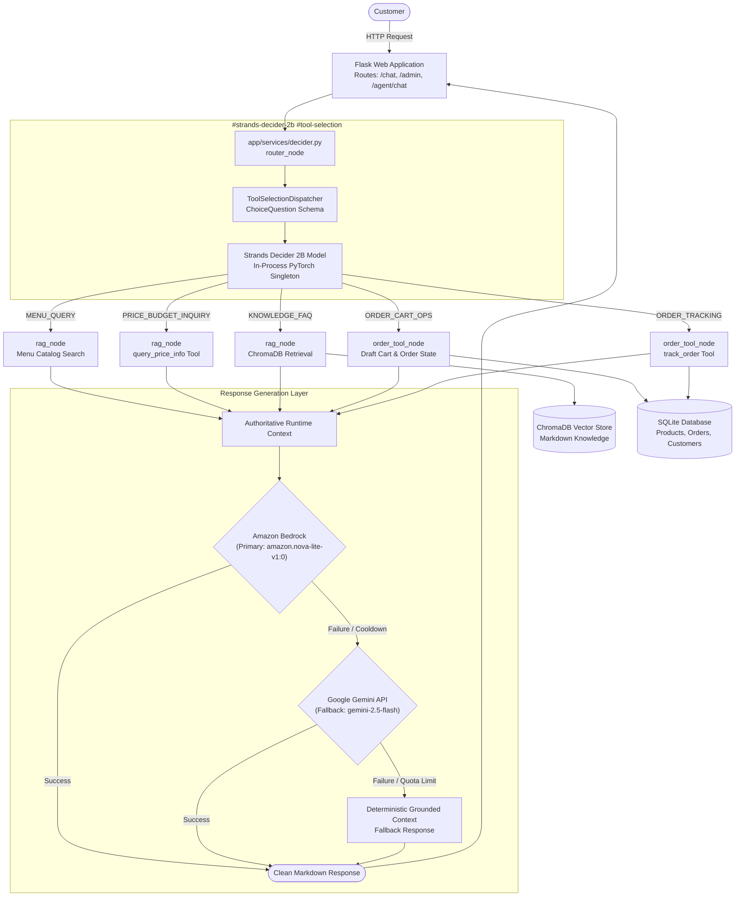

# 🍽️ Break Restaurant AI Agent | AWS Hackathon 2026

[](#-decider-2b-reusable-tool-selection-pattern)
[](#-model-providers-bedrock-primary--gemini-fallback)
[](#-model-providers-bedrock-primary--gemini-fallback)
[](#%EF%B8%8F-technology-stack)
[](#-system-architecture)
[](#-system-architecture)

**Hackathon Tags**: `#strands-decider-2b` `#tool-selection`

A stateful, production-ready restaurant conversational AI agent designed for **Break Restaurant**. Powered by **Strands Decider 2B** for low-latency `#tool-selection` decisions, **Amazon Bedrock** (`amazon.nova-lite-v1:0`) as the primary customer-facing response provider, and **Google Gemini** (`gemini-2.5-flash`) as an automatic fallback. 

The application separates customer ordering (`/chat`) from operational restaurant management (`/admin`) while maintaining transactional data consistency, zero-PII observability, and deterministic safeguards.

---

## 🌟 1. Project Overview

Diners ordering online often experience friction with rigid chatbots that fail to understand conversational nuances, misinterpret meal modifications, or hallucinate unavailable items. Restaurant staff face fragmented systems where online conversations do not translate into reliable kitchen orders.

The **Break Restaurant AI Agent** bridges this gap:
- **For Customers**: A natural, responsive chat experience that answers menu and price inquiries, clarifies dietary questions (e.g., chicken inclusions and vegetarian sides), handles branch ambiguity (e.g., *Smouha Branch 1* vs. *Smouha Branch 2*), offers guided combo upgrades, collects fulfillment details, and securely places orders.
- **For Restaurant Operators**: A comprehensive admin dashboard (`/admin`) providing live order tracking, menu synchronization, customer profiles, conversation logs, and RAG knowledge base management.

---

## 🎯 2. Features

### Customer-Facing Experience (`/chat`)
- **Intent Routing & Fast Interaction**: Real-time intent classification using Strands Decider 2B to separate greetings, menu requests, budget queries, dietary questions, and explicit ordering actions.
- **Accurate Product & Price Intelligence**: SQLite-backed menu serving exact prices in EGP (e.g., Basmatio Rice Meal at 105 EGP, Break Meal at 235 EGP) and meal price ranges (105 to 235 EGP).
- **Dietary & Delivery Transparency**:
  - Direct guidance clarifying that all main meals contain chicken, with a verified directory of vegetarian-friendly sides, sauces, and drinks.
  - Transparent delivery details across Cairo and Alexandria (25 EGP delivery fee, 30–45 minute fulfillment, cash on delivery, hotline 16099).
- **Conversational Ordering & Upselling**:
  - Interactive cart draft lifecycle with state transitions: `selecting_items` → `offering_extras` → `collecting_details` → `awaiting_confirmation` → `confirmed`.
  - Polite, optional combo upgrade (+50 EGP for fries and drink) and sauce recommendations.
  - Step-by-step fulfillment collection tailored to the channel (Delivery, Pickup, or Dine-in).
  - Explicit customer confirmation required before creating database records; draft can be cancelled at any point (e.g., *"Actually, cancel that"*).
- **Order Tracking**: Real-time status lookup using authoritative order codes (`ORD-XXXXX`).

### Operational Management Dashboard (`/admin`)
- **Live Order Management**: View, filter, update statuses (`In Kitchen`, `Out for Delivery`, `Ready for Pickup`, `Completed`, `Cancelled`), or inspect itemized receipts.
- **Product & Menu Management**: Add, edit, toggle availability, or adjust prices with instant synchronization to customer chat tools.
- **Customer CRM**: Maintain customer profiles, order history, and contact details.
- **Knowledge Base & RAG Management**: Inspect document chunks, edit markdown knowledge sources, sync embeddings, and trigger vector store rebuilds.
- **Conversation Logs**: Review historical multi-turn customer dialogues.

---

## 📐 3. System Architecture

The architecture uses deterministic Python orchestration rather than opaque graph frameworks, ensuring traceable execution and strict order idempotency:



### Execution Flow:
1. **Entry**: Customer sends a message via the web UI to `/agent/chat`. The prompt is persisted to SQLite before processing to guarantee message retention.
2. **Intent Classification**: `router_node` invokes `ToolSelectionDispatcher` using **Strands Decider 2B** to choose the appropriate tool action and execution path (`TOOLS` or `RAG`).
3. **Tool Execution**:
   - `TOOLS`: Handled by `order_tool_node` for entity extraction, draft calculations, upselling, and order lifecycle management.
   - `RAG`: Handled by `rag_node` for product price verification, menu listings, or semantic retrieval from ChromaDB.
4. **Response Generation**:
   - `llm_node` evaluates whether a deterministic response was already generated.
   - If generative synthesis is needed, it calls `reply()` in `app/services/agent.py`.
   - **Amazon Bedrock** (`amazon.nova-lite-v1:0`) is invoked as primary.
   - If Bedrock fails, times out, or is cooling down, the agent seamlessly falls back to **Google Gemini** (`gemini-2.5-flash`).
   - If both external providers are unavailable, the agent responds using the factual, grounded tool context.

---

## 🧠 4. Decider 2B Reusable `#tool-selection` Pattern

The decision architecture is implemented in [`app/services/decision_pattern.py`](file:///c:/Users/Home/Desktop/BODAA/All%20data/Projects/aws-restaurant-ai-hackathon/app/services/decision_pattern.py) and conforms to the hackathon's typed `ChoiceQuestion` specification:

### Typed ChoiceQuestion Schema
```python
from strands_decider.schema import ChoiceQuestion

question = ChoiceQuestion(
    instructions=(
        "Select the exact restaurant tool action required to handle this customer message "
        "given the active conversation state. Tags: #tool-selection #strands-decider-2b"
    ),
    criteria={
        "MENU_QUERY": (
            "Customer wants to see or explore the full food menu, list available categories, "
            "meals, sides, sauces, or drinks."
        ),
        "PRICE_BUDGET_INQUIRY": (
            "Customer is asking how much an item costs (e.g., 'What is the price of Basmatio?'), "
            "inquiring about meal prices (e.g., 'How much is a meal?'), requesting meals within a budget, "
            "or asking for dish prices."
        ),
        "ORDER_CART_OPS": (
            "Customer explicitly wants to order food, add dishes to cart (e.g., 'I want to order Break Meal'), "
            "accept/decline combo upgrades, provide checkout details (phone number, delivery address, pickup branch, payment method), "
            "or confirm an ongoing order draft. Do not choose this for greetings or general questions."
        ),
        "ORDER_TRACKING": (
            "Customer wants to check the status or progress of an existing placed order using an "
            "order code (e.g. ORD-XXXXX)."
        ),
        "KNOWLEDGE_FAQ": (
            "Customer asks general restaurant questions about branch addresses/locations, opening hours, "
            "delivery policy/service (e.g., 'Do you offer delivery?'), dietary options (e.g., vegetarian meals), "
            "cancellation policies, ingredients, contact details, or greets the assistant (e.g., 'hello', 'hi')."
        ),
    },
)
```

### Decision Output Contract
```python
class ToolDecision(TypedDict):
    tool: Literal["MENU_QUERY", "PRICE_BUDGET_INQUIRY", "ORDER_CART_OPS", "ORDER_TRACKING", "KNOWLEDGE_FAQ"]
    route: str                    # "TOOLS" if tool in (ORDER_CART_OPS, ORDER_TRACKING) else "RAG"
    confidence: float             # Normalized top-choice probability
    probabilities: dict[str, float] # Probability distribution across all 5 choices
    is_fallback: bool             # True only if neural model was unavailable
    tags: list[str]               # ["#strands-decider-2b", "#tool-selection"]
```

---

## ⚡ 5. Model Providers: Bedrock Primary & Gemini Fallback

The generative response layer implements enterprise-grade resilience in [`app/services/agent.py`](file:///c:/Users/Home/Desktop/BODAA/All%20data/Projects/aws-restaurant-ai-hackathon/app/services/agent.py):

| Attribute | Amazon Bedrock (Primary) | Google Gemini (Automatic Fallback) |
|---|---|---|
| **Model** | `amazon.nova-lite-v1:0` | `gemini-2.5-flash` |
| **SDK** | AWS SDK (`boto3`, `botocore`) via Converse API | Official Google Gen AI SDK (`google-genai`) |
| **Region** | `eu-north-1` (Stockholm) | Global endpoint |
| **Timeout** | 10 seconds (fail-fast, 1 max attempt) | 10 seconds |
| **Circuit Breaker** | 60s cooldown on throttling/transient errors; 300s on auth issues | Exponential backoff with quota-exhaustion guard |
| **Order Safety** | Read-only conversational reply; zero cart mutation | Read-only conversational reply; zero cart mutation |

### Structured Zero-PII Observability
Every model invocation emits telemetry logging the active provider, status, latency, and fallback reasons without leaking customer data:
```text
INFO:app.services.agent:provider=bedrock model=amazon.nova-lite-v1:0 status=success latency_ms=2131
INFO:app.services.decider:[TIMING] session_prefix=live_rep intent=RAG is_fallback=False route_ms=5488.0 handler=rag_node handler_ms=16.1 llm_ms=2135.7 bypassed_llm=False provider=bedrock total_ms=7639.8
```
When Bedrock encounters an error:
```text
WARNING:app.services.agent:provider=bedrock status=error error_type=ThrottlingException fallback=gemini latency_ms=12
INFO:app.services.agent:provider=gemini model=gemini-2.5-flash status=success latency_ms=1311 reason=bedrock_fallback
```
During active cooldown:
```text
INFO:app.services.agent:provider=bedrock status=skipped reason=active_cooldown remaining_cooldown_s=58.2 fallback=gemini
INFO:app.services.agent:provider=gemini model=gemini-2.5-flash status=success latency_ms=1204 reason=bedrock_cooldown
```

---

## 🛠️ 6. Technology Stack

- **Decision Small Language Model (SLM)**: [Strands Decider 2B](https://huggingface.co/StrandsAgents/strands-decider-2B-qwen3.5-v1-2610) (`#strands-decider-2b`, `#tool-selection`)
- **Primary Response LLM**: Amazon Bedrock Runtime (`amazon.nova-lite-v1:0`)
- **Fallback Generative LLM**: Google Gemini (`gemini-2.5-flash` via `google-genai` SDK)
- **Embedding & Vector Store**: ChromaDB (`chromadb`) with `gemini-embedding-001` (with lexical retrieval fallback)
- **Web Framework & API**: Python 3.12, Flask 3.0, Jinja2
- **Relational Storage & ORM**: SQLite, SQLAlchemy ORM
- **AWS Integration**: AWS SDK for Python (`boto3`, `botocore`)
- **Testing**: `pytest`

---

## 📁 7. Project Structure

```text
├── app/
│   ├── models/                # SQLAlchemy database models (Product, Order, Customer, ChatSession, ChatMessage)
│   ├── routes/                # Flask route controllers (chat view, admin dashboard, CRUD, /agent/chat)
│   ├── services/
│   │   ├── agent.py           # Bedrock primary, Gemini fallback, prompt engineering, structured telemetry
│   │   ├── decider.py         # Strands Decider 2B initialization, routing nodes, and workflow execution
│   │   ├── decision_pattern.py# Reusable #tool-selection dispatcher with typed ChoiceQuestion schema
│   │   ├── entity_recognition.py # Disambiguation for branches, contact details, payment methods
│   │   ├── order_session.py   # In-memory cart draft lifecycle, totals calculation, and DB commit
│   │   ├── tools.py           # Catalog search, pricing queries, order tracking, customer lookup
│   │   └── vector_store.py    # ChromaDB persistent vector storage and semantic retrieval
│   └── templates/
│       ├── chat.html          # Responsive customer-facing ordering chat interface
│       ├── dashboard.html     # Restaurant administration portal
│       └── base.html          # Shared layout and navigation
├── data/
│   └── chroma_db/             # Local ChromaDB persistent vector storage
├── docs/                      # Architectural guides and technical references
├── knowledge/                 # Ground truth Markdown files (menu.md, details.md)
├── tests/                     # Comprehensive automated pytest regression test suite
│   ├── test_response_provider.py # Bedrock primary, Gemini fallback, recovery, and idempotency tests
│   └── test_chat_fixes.py        # Intent routing, price lookups, dietary, and cancellation tests
├── config.py                  # Typed configuration loaded from environment variables
├── requirements.txt           # Python application dependencies
└── run.py                     # Server entry point
```

---

## 🚀 8. Setup & Installation

### Prerequisites
- Python 3.12+ installed
- AWS credentials configured locally (via AWS CLI `aws configure` or environment variables) with access to Amazon Bedrock in `eu-north-1`.
- A Google Gemini API Key (from [Google AI Studio](https://aistudio.google.com/)) for fallback generation and RAG embeddings.

### 1. Clone & Set Up Virtual Environment
```bash
git clone https://github.com/AbdelrahmanAhmed240/aws-restaurant-ai-hackathon.git
cd aws-restaurant-ai-hackathon

# Create and activate virtual environment
python -m venv .venv

# On Linux/macOS:
source .venv/bin/activate
# On Windows PowerShell:
.venv\Scripts\Activate.ps1
```

### 2. Install Dependencies
```bash
pip install -r requirements.txt
pip install boto3 botocore pytest
```

### 3. Environment Configuration
Copy `.env.example` to `.env`:
```bash
cp .env.example .env
```
Update `.env` with your settings:
```ini
# Flask
SECRET_KEY=dev-secret-key-change-in-production
PORT=5000
DEBUG=True

# Database
DATABASE_URI=sqlite:///restaurant.db

# LLM Providers
LLM_PROVIDER=bedrock
BEDROCK_ENABLED=True
AWS_REGION=eu-north-1
BEDROCK_MODEL_ID=amazon.nova-lite-v1:0
BEDROCK_TIMEOUT=10
BEDROCK_COOLDOWN_SECONDS=60

# Google Gemini API (Fallback & Embeddings)
GEMINI_API_KEY=your_gemini_api_key_here
GEMINI_MODEL=gemini-2.5-flash
GEMINI_EMBEDDING_MODEL=gemini-embedding-001

# Strands Decider 2B Mode
DECIDER_ENABLED=True
PRELOAD_DECIDER=True
DECIDER_THREADS=0
```

### 4. Run the Application
```bash
python run.py
```
- **Customer Chat**: Visit `http://localhost:5000/chat` (or `http://localhost:5000/`)
- **Admin Dashboard**: Visit `http://localhost:5000/admin`

---

## 🔄 9. Reusable Pattern: Adapting `#tool-selection`

Developers can adapt the `#tool-selection` pattern in [`app/services/decision_pattern.py`](file:///c:/Users/Home/Desktop/BODAA/All%20data/Projects/aws-restaurant-ai-hackathon/app/services/decision_pattern.py) to other domains:

1. **Define Discrete Actions**: Create a `Literal` type representing your domain tools:
   ```python
   ToolActionName = Literal["FLIGHT_SEARCH", "HOTEL_BOOKING", "CANCEL_RESERVATION", "FAQ_POLICY"]
   ```
2. **Configure Criteria**: Instantiate `ChoiceQuestion` describing the specific operational boundaries for each tool.
3. **Dispatch via Decider 2B**:
   ```python
   dispatcher = ToolSelectionDispatcher()
   question = dispatcher.get_choice_question()
   engine = get_decider_engine()
   
   # Decider 2B returns calibrated probabilities for each tool
   decision = engine.decide(question=question, message=user_message)
   selected_tool = decision.best_choice
   ```
4. **Deterministic Routing**: Route directly in Python based on `selected_tool`, passing authoritative output context to your response generator.

---

## 🧪 10. Testing

The repository contains automated unit and integration tests covering intent routing, price checks, Bedrock/Gemini provider fallback, and order idempotency.

Run the test suite:
```bash
python -m pytest tests/ -v
```

### Verified Test Areas:
- `test_response_provider.py`: Verifies Amazon Bedrock as primary, Gemini fallback on throttling, cooldown skipping, automatic recovery after timeout, and order idempotency.
- `test_chat_fixes.py`: Verifies greetings, delivery policy queries, dietary inquiries, specific meal ordering with prices, and unconfirmed order cancellations.

---

## ⚠️ 11. Limitations & References

### Known Limitations
- **Local Storage Architecture**: SQLite and ChromaDB persist to local disk (`restaurant.db`, `data/chroma_db/`), suited for single-instance or demonstration deployment. Multi-instance production requires managed Amazon RDS (PostgreSQL) and Amazon OpenSearch Serverless.
- **CPU Inference for Decider 2B**: By default, Strands Decider 2B runs on host CPU with PyTorch. A host machine with at least 8 GB of RAM is recommended for optimal cold-start loading times.

### References & Documentation
- [Strands Decider 2B Model on Hugging Face](https://huggingface.co/StrandsAgents/strands-decider-2B-qwen3.5-v1-2610)
- [Amazon Bedrock Converse API Documentation](https://docs.aws.amazon.com/bedrock/latest/userguide/conversation-inference.html)
- [Google Gen AI SDK Python Documentation](https://github.com/googleapis/python-genai)
- [Flask Documentation](https://flask.palletsprojects.com/)
- [ChromaDB Documentation](https://docs.trychroma.com/)
- [Detailed Architecture Reference (`docs/ARCHITECTURE_GUIDE.md`)](file:///c:/Users/Home/Desktop/BODAA/All%20data/Projects/aws-restaurant-ai-hackathon/docs/ARCHITECTURE_GUIDE.md)
