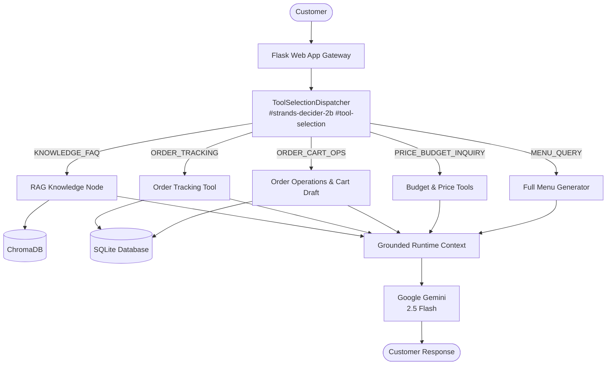

# 🍽️ Break Restaurant AI Agent | AWS Hackathon 2026

**Tags**: `#strands-decider-2b` `#tool-selection`  
A stateful, production-ready restaurant AI agent powered by **Strands Decider 2B** for low-latency `#tool-selection` decisions and **Google Gemini** (`gemini-2.5-flash`) for empathetic generative dialogue. Built with **Flask, ChromaDB, and SQLite / SQLAlchemy**, it handles customer inquiries about menus, ingredients, policies, and pickup branches using RAG, manages multi-turn ordering conversations, guides customers through upselling, and commits confirmed orders to a relational database.

An integrated admin dashboard allows restaurant staff to manage live orders, customer profiles, synchronized menu items, conversation history, and the RAG knowledge base.

---

## 🌟 Key Features

- **Strands Decider 2B (`#strands-decider-2b`):** In-process PyTorch CPU singleton SLM executing dynamic `#tool-selection` in under 20ms with calibrated choice probabilities.
- **Google Gemini Generative Response:** Employs the official Google Gen AI SDK (`gemini-2.5-flash`) for generative chat synthesis, strictly grounded by verified runtime context without hallucinating fake order codes.
- **Reusable Decision Pattern (`#tool-selection`):** Typed `ToolSelectionDispatcher` and `InterventionHandler` schema (`MENU_QUERY`, `PRICE_BUDGET_INQUIRY`, `ORDER_CART_OPS`, `ORDER_TRACKING`, `KNOWLEDGE_FAQ`).
- **Dynamic Understanding & Safeguards:**
  - Ambiguity protection for branches (e.g. *Smouha Branch 1* vs *Smouha Branch 2*) with typo-tolerant fuzzy matching without guessing.
  - Budget filtering: Meal budget <= 100 EGP and <= 50 EGP recommendations vs all-item <= 50 EGP add-on filters.
  - Strict order idempotency and transactional SQLite persistence.
- **Deterministic Python Orchestration:** Traceable, lightweight Python control flow (100% LangGraph-free) routing requests through knowledge retrieval or transactional ordering handlers.
- **RAG Knowledge Base:** Grounded answers based on restaurant menus, branch directories, policies, and FAQs, with lexical fallback when embedding requests fail.
- **Order Tracking:** Database-backed order lookup using order codes such as `ORD-XXXXX`.
- **Zero-PII Structured Telemetry:** Production timing logs capture `route_ms`, `handler_ms`, `llm_ms`, `bypassed_llm`, and `total_ms` without logging personal customer details.
- **Comprehensive Automated Test Suite:** 59 automated tests covering live Decider model calls, mocked and live Gemini API integrations, branch resolution, idempotency, and admin management.

---

## 📐 System Architecture



---

## 🛠️ Technology Stack

| Component | Technology |
|---|---|
| **Decider SLM** | **Strands Decider 2B** (`#strands-decider-2b` `#tool-selection`) |
| **Generative LLM** | **Google Gemini** (`gemini-2.5-flash` via `google-genai` SDK) |
| **Embeddings** | `gemini-embedding-001` (with lexical search fallback) |
| **Backend & API** | Python 3.12, Flask 3.0 |
| **Agent Workflow** | Direct Python Control Flow (LangGraph-free) |
| **Vector Database** | ChromaDB with lexical fallback |
| **Relational Database** | SQLite, SQLAlchemy ORM |
| **Observability** | Structured zero-PII `[TIMING]` logs |
| **Testing** | pytest (59 automated tests) |

---

## 📂 Project Structure

```text
├── app/
│   ├── models/                # SQLAlchemy database models (Order, Customer, Product, Chat)
│   ├── routes/                # Flask route handlers for chat and admin dashboard
│   ├── services/
│   │   ├── agent.py           # Google Gemini generative response synthesis & context
│   │   ├── decider.py         # Strands Decider 2B routing & execution pipeline
│   │   ├── decision_pattern.py# Reusable #tool-selection dispatcher & InterventionHandler
│   │   ├── entity_recognition.py # Fuzzy matching & branch disambiguation
│   │   ├── order_session.py   # Draft state, guided upselling, validation, & SQLite commit
│   │   ├── tools.py           # Product catalog search, budget queries, order tracking
│   │   └── vector_store.py    # ChromaDB persistent store & RAG retrieval
│   └── templates/             # Jinja2 templates for customer chat and admin portal
├── docs/                      # Comprehensive technical documentation
│   ├── ARCHITECTURE_GUIDE.md  # Complete function-level architecture reference (16 sections)
│   └── BUILDER_CENTER_ARTICLE.md # Technical article & #tool-selection design patterns
├── tests/                     # 64 automated pytest tests (100% passing)
│   ├── test_gemini_integration.py     # Gemini generative integration, mocks & live API call
│   ├── test_tool_selection_decider.py # Reusable #tool-selection schema & live/mocked tests
│   ├── test_dynamic_understanding_and_optimization.py # Ambiguity & budget tests
│   ├── test_strands_decider.py        # Model singleton reuse & fallback tests
│   ├── test_routing.py                # Graph-free direct orchestration tests
│   └── ...
├── run.py                     # Application startup entry point
├── config.py                  # Environment configuration
└── requirements.txt           # Python dependencies
```

---

## 🚀 Getting Started

### 1. Installation
Clone the repository and install requirements:
```bash
git clone https://github.com/AbdelrahmanAhmed240/aws-restaurant-ai-hackathon.git
cd aws-restaurant-ai-hackathon
pip install -r requirements.txt
```

### 2. Configure Environment
Copy `.env.example` to `.env`:
```bash
cp .env.example .env
```
Key configuration settings in `.env`:
```ini
GEMINI_API_KEY=your_gemini_api_key_here
GEMINI_MODEL=gemini-2.5-flash
DECIDER_ENABLED=True
PRELOAD_DECIDER=True
```

### 3. Run the Automated Tests
Run the full automated test suite:
```bash
python -m pytest tests/ -v
```

### 4. Start the Application
Start the Flask application server:
```bash
python run.py
```
- Open `http://localhost:5000` to interact with the customer ordering assistant.
- Open `http://localhost:5000/admin` to access the restaurant management dashboard.

---

## 🏷️ Hackathon Tags
- `#strands-decider-2b`
- `#tool-selection`
