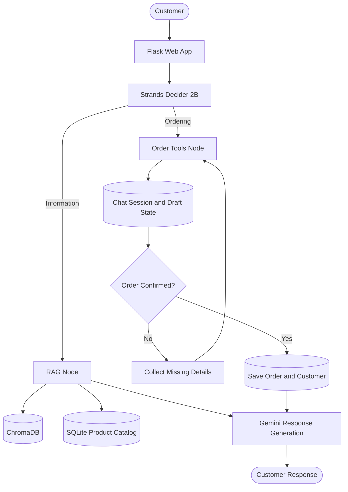

# 🍽️ Restaurant AI Agent | AWS Hackathon 2026

A restaurant AI agent built with **Flask, Strands Decider 2B, Google Gemini, ChromaDB, and SQLAlchemy**. It handles customer inquiries about menus, ingredients, policies, and pickup branches using Retrieval-Augmented Generation (RAG), manages multi-turn ordering conversations, guides customers through upselling, and commits confirmed orders to a relational database.

An integrated admin dashboard allows restaurant staff to manage orders, customer profiles, menu items, conversations, and the RAG knowledge base.

## 🌟 Key Features

- **Strands Decider 2B:** Local intent classification with PyTorch CPU inference, singleton engine reuse, and fallback routing.
- **LangGraph Orchestration:** Routes requests through information retrieval or order-processing workflows.
- **RAG Knowledge Base:** Grounded answers based on restaurant menus, branch directories, policies, and FAQs, with lexical fallback when embedding requests fail.
- **Conversational Ordering:** Multi-turn cart management, guided upselling for combos and extras, fulfillment details, and explicit order confirmation.
- **Authoritative Menu & Branch Directory:** Structured menu information and branch listings grouped by Cairo and Alexandria.
- **Database Synchronization:** SQLite and SQLAlchemy manage customer profiles, orders, itemized totals, and persistent chat sessions.
- **Order Tracking:** Database-backed order lookup using order codes such as `ORD-XXXXX`.
- **Admin Dashboard:** Manage products, orders, customers, conversations, and knowledge records.
- **Chat Management:** Create independent conversations and delete chats without deleting confirmed orders or customer records.

## 📐 System Architecture



## 🛠️ Technology Stack

| Component | Technology |
|---|---|
| Backend | Python, Flask |
| Agent Workflow | LangGraph |
| Intent Classification | Strands Decider 2B |
| Language Model | Google Gemini |
| Embeddings | `gemini-embedding-001` |
| Vector Database | ChromaDB |
| Relational Database | SQLite, SQLAlchemy |
| Frontend | HTML, CSS, JavaScript, Jinja2 |
| Testing | pytest |

## 📂 Project Structure

```text
app/
├── models/              # SQLAlchemy database models
├── routes/              # Dashboard and API endpoints
├── services/
│   ├── agent.py         # Gemini integration and chat history
│   ├── chunker.py       # Markdown parsing and chunking
│   ├── decider.py       # LangGraph workflow and Decider routing
│   ├── embeddings.py    # Google embedding client
│   ├── knowledge_sync.py# Knowledge synchronization and indexing
│   ├── order_session.py # Draft state and order detail extraction
│   ├── tools.py         # Order and product database operations
│   └── vector_store.py  # ChromaDB retrieval and lexical fallback
└── templates/           # Dashboard and chat UI
knowledge/
├── menu.md              # Authoritative menu and pricing
└── details.md           # Branches, policies, hours, and FAQs
tests/                   # Automated regression and functional tests
config.py                # Application configuration
db_explorer.py           # Database inspection utility
requirements.txt         # Python dependencies
run.py                   # Application entry point
.env.example             # Environment template
.gitignore               # Ignored files and secrets
```

## 🚀 Setup & Quickstart

### 1. Prerequisites

- Python 3.10–3.12
- Git
- A Google Gemini API key

### 2. Clone and Install

```bash
git clone https://github.com/<your-username>/<your-repo-name>.git
cd <your-repo-name>

python -m venv venv
```

Activate the virtual environment.

**Windows PowerShell**
```powershell
venv\Scripts\Activate.ps1
```

**Linux / macOS**
```bash
source venv/bin/activate
```

Install dependencies:

```bash
pip install -r requirements.txt
```

### 3. Configure Environment Variables

Copy `.env.example` to `.env`.

**Windows PowerShell**
```powershell
Copy-Item .env.example .env
```

**Linux / macOS**
```bash
cp .env.example .env
```

Configure your API key and application settings:

```env
SECRET_KEY=replace-with-a-secure-secret
PORT=5000

DATABASE_URI=sqlite:///restaurant.db
CHROMA_PERSIST_DIR=./data/chroma_db

GEMINI_API_KEY=your_gemini_api_key_here
GEMINI_MODEL=gemini-2.5-flash
GEMINI_EMBEDDING_MODEL=gemini-embedding-001

DECIDER_ENABLED=True
PRELOAD_DECIDER=True
DECIDER_THREADS=0
```

Get your API key from [Google AI Studio](https://aistudio.google.com/).

**Never commit your actual `.env` file or API credentials.**

### 4. Start the Application

```bash
python run.py
```

At startup, the application initializes its database and loads the Strands Decider model when preloading is enabled. Menu synchronization depends on the application's configured initialization workflow.

Open:

- Application: `http://127.0.0.1:5000/`
- Admin dashboard: `http://127.0.0.1:5000/admin/`
- Knowledge management: `http://127.0.0.1:5000/admin/knowledge`

### 5. Build the RAG Index

After configuring the API key, open the knowledge management page and use **Rebuild Vectors** to index the knowledge base.

If the embedding API quota is exhausted, lexical fallback may help retrieve existing knowledge without generating new query embeddings.

## ⚙️ Configuration Reference

| Variable | Description | Default |
|---|---|---|
| `GEMINI_API_KEY` | Google Gemini API key | Required for live Gemini requests |
| `GEMINI_MODEL` | Text-generation model | `gemini-2.5-flash` |
| `GEMINI_EMBEDDING_MODEL` | Embedding model | `gemini-embedding-001` |
| `DECIDER_ENABLED` | Enables Strands Decider routing | `True` |
| `PRELOAD_DECIDER` | Loads the model during startup | `True` |
| `DECIDER_THREADS` | PyTorch CPU thread setting; `0` means automatic | `0` |
| `DATABASE_URI` | SQLAlchemy database connection | `sqlite:///restaurant.db` |
| `CHROMA_PERSIST_DIR` | Persistent vector-store directory | `./data/chroma_db` |

## 🛡️ Security

- Keep API keys and secrets out of version control.
- Use a secure `SECRET_KEY` outside local development.
- Protect admin routes and validate state-changing requests.
- Back up persistent data before destructive database operations.
