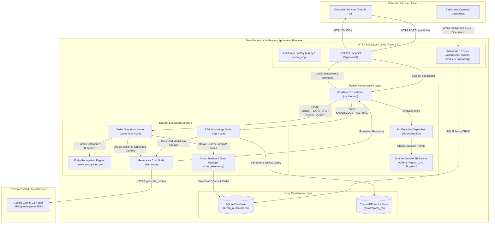
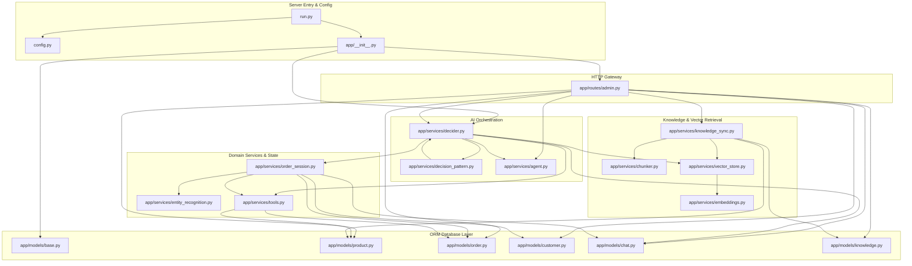
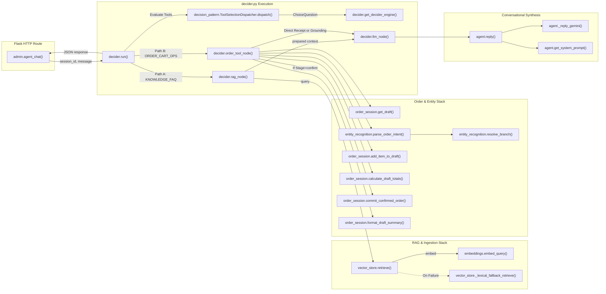
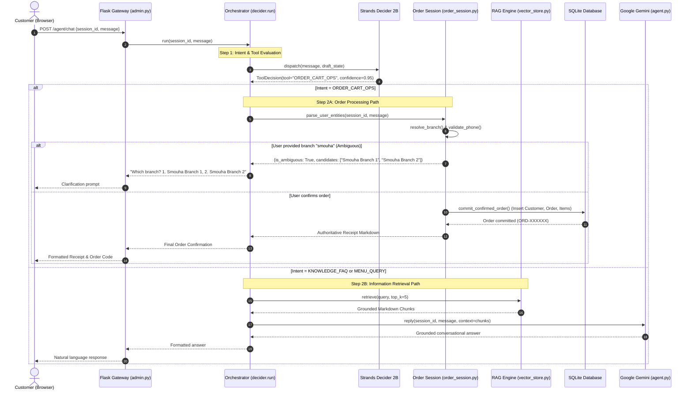
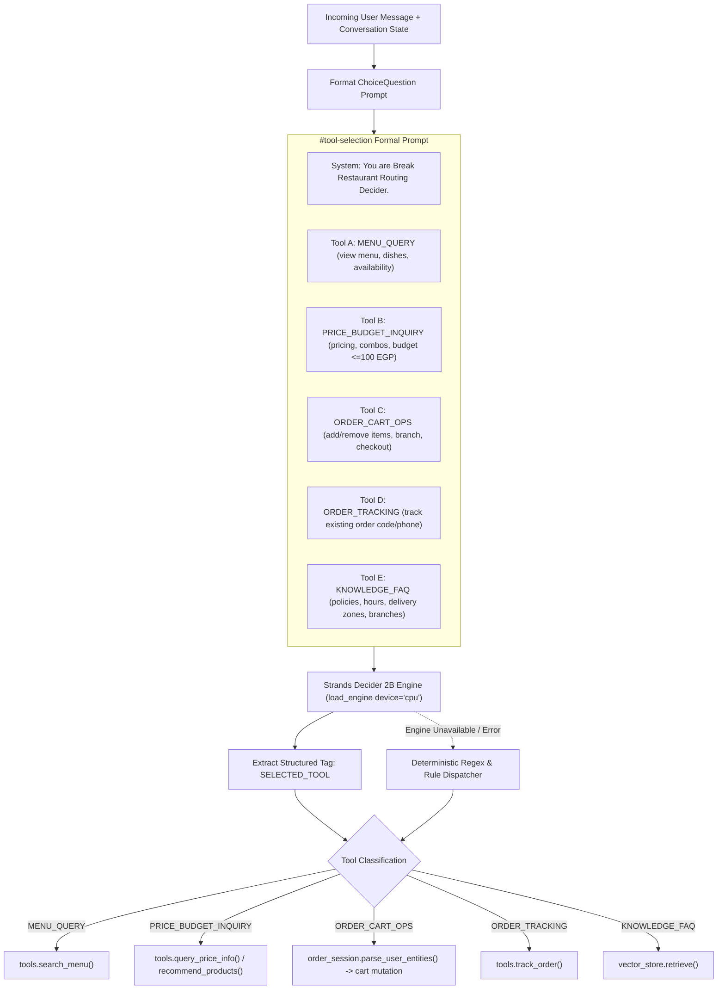
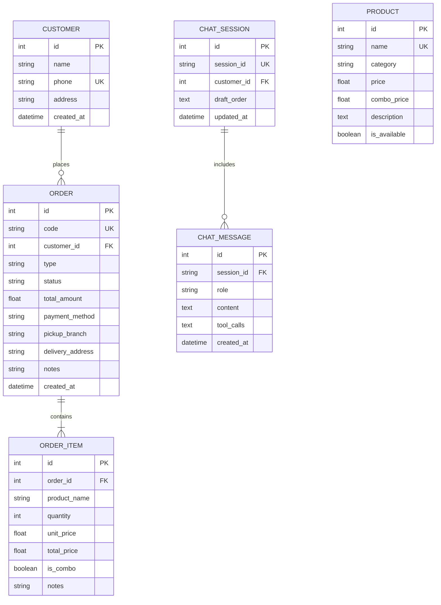
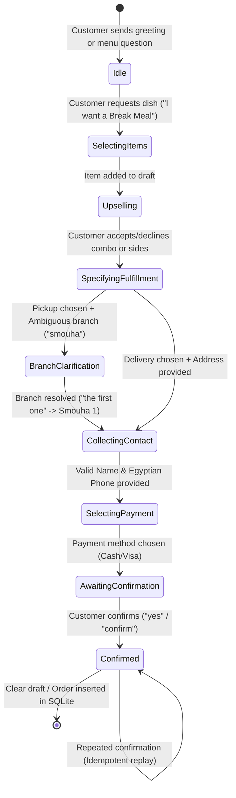
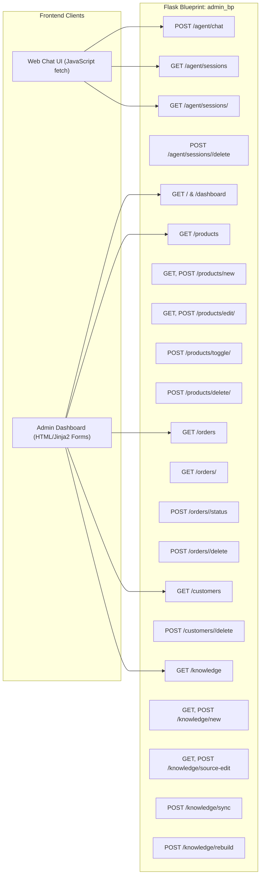
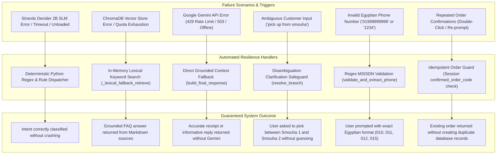

# Break Restaurant AI Chatbot — Comprehensive Function-Level Architecture Guide

> **System Version:** 2.0.0 (Clean Python Dispatcher & Singleton SLM Runtime)  
> **Architecture Style:** Decoupled In-Process SLM Routing + RAG + SQLite State Machine + Managed Generative Synthesis  
> **Target Environment:** Python 3.12, Flask, PyTorch CPU, ChromaDB, SQLAlchemy SQLite, Google Gemini 2.5 Flash

---

## Table of Contents
1. [Executive Summary & Architectural Overview](#1-executive-summary--architectural-overview)
2. [System Topology & Trust Boundaries (Diagram A)](#2-system-topology--trust-boundaries-diagram-a)
3. [Hierarchical Repository Map](#3-hierarchical-repository-map)
4. [File-to-File Dependency Graph (Diagram B)](#4-file-to-file-dependency-graph-diagram-b)
5. [Function-Level Call Graph (Diagram C)](#5-function-level-call-graph-diagram-c)
6. [Customer Message Execution Lifecycle (Diagram D)](#6-customer-message-execution-lifecycle-diagram-d)
7. [AI Decision Engine & Tool Routing (Diagram E)](#7-ai-decision-engine--tool-routing-diagram-e)
8. [Knowledge Retrieval & RAG Pipeline (Diagram F)](#8-knowledge-retrieval--rag-pipeline-diagram-f)
9. [Database Architecture & Order State Machine (Diagram G)](#9-database-architecture--order-state-machine-diagram-g)
10. [Frontend-to-Backend API Contract (Diagram H)](#10-frontend-to-backend-api-contract-diagram-h)
11. [Resilience, Error Handling & Fallback Paths (Diagram I)](#11-resilience-error-handling--fallback-paths-diagram-i)
12. [Structured Function Connection Index](#12-structured-function-connection-index)
13. [Complete API Endpoint Inventory](#13-complete-api-endpoint-inventory)
14. [Test Suite Mapping & Verification Matrix](#14-test-suite-mapping--verification-matrix)
15. [Architectural Invariants & Anti-Patterns Prevented](#15-architectural-invariants--anti-patterns-prevented)
16. [Interactive Archify Diagram Specification](#16-interactive-archify-diagram-specification)

---

## 1. Executive Summary & Architectural Overview

The **Break Restaurant AI Chatbot** is a production-oriented conversational commerce platform specifically built for food ordering, menu exploration, policy FAQs, and customer order management. The architecture balances strict data determinism (financial accuracy, zero duplicate orders, exact price matching) with natural-language flexibility (typo-tolerant entity extraction, Egyptian phone number parsing, and conversational fluency).

### Core Architectural Principles:
1. **Decoupled AI Concerns:**
   - **Strands Decider 2B (`strands-decider-2B-qwen3.5-v1-2610`):** An in-process, CPU-optimized Small Language Model (SLM) executing strictly formatted `#tool-selection` prompts to determine intent (`MENU_QUERY`, `PRICE_BUDGET_INQUIRY`, `ORDER_CART_OPS`, `ORDER_TRACKING`, `KNOWLEDGE_FAQ`).
   - **Google Gemini 2.5 Flash:** Cloud LLM accessed via the official `google-genai` SDK used exclusively for conversational customer-facing language synthesis, strictly grounded on verified facts from database and RAG tools.
2. **Linear Control Flow over Complex Graphs:**
   - Replaced fragile cyclic graph engines (LangGraph) with a maintainable, deterministic Python pipeline in `app/services/decider.py` that handles state routing, tool execution, session persistence, and timing telemetry.
3. **Deterministic Business Core:**
   - Menu pricing, combo calculations (+50 EGP), budget filtering (strict <= 100 EGP meal vs sides handling), branch ambiguity clarification (no guessing between Smouha 1 and 2), and order commits execute entirely in deterministic Python and ACID-compliant SQLite.
4. **Resilient Knowledge Fallback:**
   - ChromaDB persistent vector storage embeds markdown knowledge; if embeddings fail or API quotas exhaust, an in-memory lexical fallback guarantees continuous operation.

---

## 2. System Topology & Trust Boundaries (Diagram A)



---

## 3. Hierarchical Repository Map

```
aws-restaurant-ai-hackathon/
│
├── run.py                                    # Server entry point; initializes Flask app on PORT 5000
│   └── app = create_app()
│
├── config.py                                 # Centralized environment configuration
│   └── class Config                          # Resolves DB URIs, model checkpoints, Gemini keys, debug modes
│
├── db_explorer.py                            # CLI debugging utility for SQLite inspection
│   ├── view_all_tables()
│   ├── view_table_schema()
│   └── inspect_orders()
│
├── app/
│   ├── __init__.py                           # Flask Application Factory
│   │   ├── create_app(test_config=None)      # Registers Blueprints, initializes DB, preloads Decider engine
│   │   └── _preload_decider()                # Background thread preloading Strands Decider 2B
│   │
│   ├── models/                               # SQLAlchemy ORM Models (SQLite)
│   │   ├── base.py                           # Database singleton: db = SQLAlchemy()
│   │   ├── product.py                        # Product model: id, name, category, price, combo_price, is_available
│   │   │   └── class Product
│   │   ├── customer.py                       # Customer model: id, name, phone, address, created_at
│   │   │   └── class Customer
│   │   ├── order.py                          # Order & OrderItem models
│   │   │   ├── class Order                   # code, customer_id, type, status, total, payment_method, branch
│   │   │   └── class OrderItem               # order_id, product_name, quantity, price, is_combo, notes
│   │   ├── knowledge.py                      # Knowledge base models
│   │   │   ├── class KnowledgeItem           # category, question, answer, source_file
│   │   │   └── class KnowledgeChunk          # chunk_id, document, content, metadata_json
│   │   └── chat.py                           # Conversation session models
│   │       ├── class ChatSession             # session_id, customer_id, draft_order, updated_at
│   │       └── class ChatMessage             # session_id, role, content, tool_calls, created_at
│   │
│   ├── routes/
│   │   └── admin.py                          # Unified Web and Chat Route Blueprint (admin_bp)
│   │       ├── dashboard()                   # GET  / & /dashboard
│   │       ├── products()                    # GET  /products
│   │       ├── new_product()                 # GET, POST /products/new
│   │       ├── edit_product()                # GET, POST /products/edit/<int:product_id>
│   │       ├── toggle_product()              # POST /products/toggle/<int:product_id>
│   │       ├── delete_product()              # POST /products/delete/<int:product_id>
│   │       ├── orders()                      # GET  /orders
│   │       ├── order_detail()                # GET  /orders/<int:order_id>
│   │       ├── update_order_status()         # POST /orders/<int:order_id>/status
│   │       ├── delete_order()                # POST /orders/<int:order_id>/delete
│   │       ├── customers()                   # GET  /customers
│   │       ├── delete_customer()             # POST /customers/<int:customer_id>/delete
│   │       ├── knowledge()                   # GET  /knowledge
│   │       ├── new_knowledge()               # GET, POST /knowledge/new
│   │       ├── edit_knowledge()              # GET, POST /knowledge/edit/<int:item_id>
│   │       ├── delete_knowledge()            # POST /knowledge/delete/<int:item_id>
│   │       ├── edit_knowledge_source()       # GET, POST /knowledge/source-edit
│   │       ├── knowledge_chunk_detail()      # GET  /knowledge/chunks/<chunk_id>
│   │       ├── sync_knowledge_route()        # POST /knowledge/sync
│   │       ├── rebuild_knowledge_route()     # POST /knowledge/rebuild
│   │       ├── agent_chat()                  # POST /agent/chat (Primary conversational API)
│   │       ├── list_chat_sessions()          # GET  /agent/sessions
│   │       ├── get_chat_session_history()    # GET  /agent/sessions/<session_id>
│   │       └── delete_chat_session()         # POST /agent/sessions/<session_id>/delete
│   │
│   └── services/                             # Core Business, AI, and Ingestion Services
│       ├── decider.py                        # Central Orchestrator & SLM Model Host
│       │   ├── get_decider_engine()          # Thread-safe Singleton loader for Strands Decider 2B
│       │   ├── set_decider_disabled()        # Test / Debug toggle for Decider SLM
│       │   ├── is_decider_disabled()         # Decider status flag
│       │   ├── run(session_id, message)      # Primary workflow entry point (replaces graph)
│       │   ├── rag_node(state)               # Path A: RAG retrieval & prompt formulation
│       │   ├── order_tool_node(state)        # Path B: Deterministic order and menu operations
│       │   ├── llm_node(state)               # Invokes Gemini synthesis with grounded context
│       │   └── build_final_response()        # Direct receipt formatting and fallback assembly
│       │
│       ├── decision_pattern.py               # Strands Decider 2B Prompt & Schema Contract
│       │   ├── class ToolSelectionDispatcher # Builds ChoiceQuestion prompt, executes SLM, extracts tool
│       │   └── class InterventionHandler     # Evaluates state divergence & user correction triggers
│       │
│       ├── entity_recognition.py             # Deterministic NLP, Typo Tolerance & Disambiguation
│       │   ├── resolve_branch()              # Fuzzy branch parser with Smouha 1 & 2 ambiguity checks
│       │   ├── resolve_fulfillment_type()    # Clause-level negation-aware delivery vs pickup parser
│       │   ├── resolve_payment_method()      # Clause-level negation-aware Cash vs Visa parser
│       │   ├── validate_and_extract_phone()  # Strict Egyptian MSISDN parser (010, 011, 012, 015)
│       │   ├── extract_customer_name()       # Non-keyword name token parser
│       │   └── parse_order_intent()          # Multi-entity simultaneous extractor
│       │
│       ├── order_session.py                  # Draft Order State Machine & Persistence
│       │   ├── get_draft()                   # Retrieves draft from SQLite or creates initial state
│       │   ├── update_draft()                # Updates draft state and writes to ChatSession
│       │   ├── clear_draft()                 # Resets session state
│       │   ├── add_item_to_draft()           # Adds items to draft with combo flag
│       │   ├── remove_item_from_draft()      # Removes items from draft
│       │   ├── calculate_draft_totals()      # Computes subtotal, taxes, delivery, grand total
│       │   ├── get_missing_fields()          # Identifies remaining fulfillment prerequisites
│       │   ├── get_upsell_suggestions()      # Recommends drinks/sides/combos (+50 EGP)
│       │   ├── format_draft_summary()        # Generates Markdown receipt summary
│       │   └── commit_confirmed_order()      # Atomically inserts Customer, Order, OrderItems in SQLite
│       │
│       ├── tools.py                          # Catalog Querying & Budget Enforcement Tools
│       │   ├── search_menu()                 # Keyword & category menu search
│       │   ├── query_price_info()            # Strict price lookup and combo upgrade calculation
│       │   ├── recommend_products()          # Budget-enforced recommendation (<= 100 EGP meal guard)
│       │   └── track_order()                 # SQLite order status lookup by code or phone
│       │
│       ├── vector_store.py                   # ChromaDB Vector Store & Lexical Fallback
│       │   ├── get_client()                  # Persistent ChromaDB client singleton
│       │   ├── get_collection()              # Shared 'break_restaurant_knowledge' collection
│       │   ├── add_chunks()                  # Inserts document vectors and metadata
│       │   ├── upsert_chunks()               # Upserts vectors and metadata
│       │   ├── reset_collection()            # Re-indexes ChromaDB collection cleanly
│       │   ├── delete_chunks()               # Removes chunk records by ID
│       │   ├── retrieve()                    # Cosine distance semantic retrieval with fallback
│       │   └── _lexical_fallback_retrieve()  # In-memory keyword search across Markdown files
│       │
│       ├── embeddings.py                     # Vector Embedding Generation
│       │   ├── embed_texts()                 # Batch text embedding via Gemini text-embedding-004
│       │   └── embed_query()                 # Single text query embedding
│       │
│       ├── chunker.py                        # Markdown Document Chunking Engine
│       │   └── chunk_markdown()              # Header-aware Markdown chunking (H1/H2/H3 splitting)
│       │
│       ├── knowledge_sync.py                 # Markdown Knowledge Synchronizer
│       │   ├── sync_products_from_menu_markdown() # Syncs knowledge/menu.md -> Product SQLite table
│       │   └── sync_knowledge_to_db()        # Syncs knowledge/*.md -> ChromaDB & KnowledgeChunk table
│       │
│       └── agent.py                          # Gemini Conversational Synthesis Service
│           ├── get_gemini_client()           # Google GenAI client initializer
│           ├── set_gemini_client()           # Mock injection for testing
│           ├── get_history()                 # In-memory session chat history retriever
│           ├── clear_history()               # Session history purge
│           ├── get_system_prompt()           # Grounded system prompt generator
│           ├── _strip_reasoning()            # Clean formatting filter
│           ├── _reply_gemini()               # Raw Gemini API call with grounding injection
│           └── reply()                       # Public synthesis wrapper with timeout & error guards
│
├── knowledge/                                # Ground Truth Knowledge Sources
│   ├── details.md                            # Branches, addresses, opening hours, policies, FAQs
│   └── menu.md                               # Authoritative restaurant menu, prices, and combos
│
├── tests/                                    # Automated Test Suite (64 Verified Passing Tests)
│   ├── conftest.py                           # Pytest fixtures and mock client setup
│   ├── test_branch_inquiry.py                # Verifies branch retrieval and RAG integration (4 tests)
│   ├── test_chat_management.py               # Tests chat session CRUD and agent interaction (5 tests)
│   ├── test_customer_sync.py                 # Tests customer record creation on order placement (4 tests)
│   ├── test_dev_mode.py                      # Tests offline and development configuration (3 tests)
│   ├── test_dynamic_understanding_and_optimization.py # Tests branch ambiguity, phone, negation, budget (9 tests)
│   ├── test_full_menu.py                     # Tests comprehensive menu browsing and categorization (3 tests)
│   ├── test_gemini_integration.py            # Tests Gemini grounding and offline fallbacks (7 tests)
│   ├── test_menu_sync.py                     # Tests Markdown parsing and SQLite/ChromaDB sync (8 tests)
│   ├── test_order_confirmation_bug.py        # Tests idempotent order confirmation (3 tests)
│   ├── test_routing.py                       # Tests intent classification across all tools (9 tests)
│   ├── test_strands_decider.py               # Tests Strands Decider 2B singleton lifecycle (4 tests)
│   └── test_tool_selection_decider.py        # Tests ChoiceQuestion tool dispatch (5 tests)
│
└── .archify/                                 # Visual Architecture Model
    └── architecture-runtime-overview-20261020-145227/
        ├── candidate.json                    # Formatted machine-readable visual specification
        └── runtime-overview.html             # Standalone interactive architecture viewer
```

---

## 4. File-to-File Dependency Graph (Diagram B)



---

## 5. Function-Level Call Graph (Diagram C)



---

## 6. Customer Message Execution Lifecycle (Diagram D)



---

## 7. AI Decision Engine & Tool Routing (Diagram E)

The Strands Decider 2B engine operates as a singleton SLM loaded directly into host memory on CPU (`app/services/decider.py` & `app/services/decision_pattern.py`).



---

## 8. Knowledge Retrieval & RAG Pipeline (Diagram F)

```mermaid
flowchart TD
    subgraph Ingestion_Pipeline["Offline / Admin Sync Pipeline (knowledge_sync.py)"]
        MD_Menu["knowledge/menu.md"] --> P_Sync["sync_products_from_menu_markdown()"]
        MD_Details["knowledge/details.md"] --> K_Sync["sync_knowledge_to_db()"]
        
        P_Sync --> SQLite_Prod[("SQLite: products table")]
        
        K_Sync --> Chunker["chunker.chunk_markdown(headers=['#', '##', '###'])"]
        Chunker --> Chunks["List[Dict] Chunks (id, title, content)"]
        Chunks --> EmbedBatch["embeddings.embed_texts() (text-embedding-004)"]
        EmbedBatch --> ChromaStore[("ChromaDB: break_restaurant_knowledge")]
        Chunks --> SQLite_Chunks[("SQLite: knowledge_chunks table")]
    end

    subgraph Runtime_Query_Pipeline["Runtime Retrieval Pipeline (vector_store.py)"]
        UserQ["User Query (e.g. 'What are the branches?')"] --> EmbedQ["embeddings.embed_query()"]
        EmbedQ --> VectorSearch["ChromaDB.query(query_embeddings, n_results=5)"]
        
        VectorSearch --> Success{"Embedding & Vector Search Succeeded?"}
        Success -->|Yes| ChunksOut["Top-k Relevant Chunks"]
        Success -->|No / API Failure| LexFallback["vector_store._lexical_fallback_retrieve()"]
        
        LexFallback --> ReadFiles["Direct Regex & Keyword Scan (knowledge/*.md)"]
        ReadFiles --> ChunksOut
        
        ChunksOut --> InjectContext["Inject into agent.get_system_prompt()"]
        InjectContext --> GeminiGen["agent._reply_gemini()"]
    end
```



---

## 9. Database Architecture & Order State Machine (Diagram G)

### SQLite Relational Schema (ERD)



### Order Session State Transitions



---

## 10. Frontend-to-Backend API Contract (Diagram H)



---

## 11. Resilience, Error Handling & Fallback Paths (Diagram I)



---

## 12. Structured Function Connection Index

This index provides exact, verifiable connections (`source::func() → target::func()`) across the codebase.

| # | Source File & Function | Target File & Function | Relationship | Data In | Data Out | Purpose & Evidence |
|---|------------------------|------------------------|--------------|---------|----------|---------------------|
| 1 | `run.py::<module>` (L5) | `app/__init__.py::create_app()` (L12) | Direct call | Test/env configs | Flask app instance | Initializes database, blueprints, and preloads decider engine on startup. |
| 2 | `app/routes/admin.py::agent_chat()` (L461) | `app/services/decider.py::run()` (L1094) | Direct call | `session_id: str, message: str` | `dict` (response, intent, timing) | Primary chat entry point routing customer input into the workflow engine. |
| 3 | `app/services/decider.py::run()` (L1094) | `app/services/decision_pattern.py::ToolSelectionDispatcher.dispatch()` (L64) | Direct call | `message: str, draft: dict` | `ToolDecision` (tool, confidence) | Formulates `#tool-selection` ChoiceQuestion and invokes SLM to classify intent. |
| 4 | `app/services/decision_pattern.py::dispatch()` (L82) | `app/services/decider.py::get_decider_engine()` (L55) | Direct call | None | PyTorch engine singleton | Retrieves or thread-safely initializes the Strands Decider 2B PyTorch model. |
| 5 | `app/services/decider.py::run()` (L1130) | `app/services/decider.py::rag_node()` (L445) | Direct call | `state: AgentState` | `AgentState` | Executes Path A: Retrieves grounded knowledge chunks for FAQs and policy inquiries. |
| 6 | `app/services/decider.py::rag_node()` (L455) | `app/services/vector_store.py::retrieve()` (L98) | Direct call | `query: str, top_k: int` | `List[Dict]` (chunks) | Semantic vector retrieval with automatic fallback to keyword search. |
| 7 | `app/services/vector_store.py::retrieve()` (L105) | `app/services/embeddings.py::embed_query()` (L25) | Direct call | `text: str` | `List[float]` (vector) | Projects user query into the 768-dim embedding space using Gemini embeddings. |
| 8 | `app/services/vector_store.py::retrieve()` (L125) | `app/services/vector_store.py::_lexical_fallback_retrieve()` (L135) | Fallback call | `query: str, top_k: int` | `List[Dict]` (chunks) | In-memory keyword fallback executing directly against `knowledge/*.md`. |
| 9 | `app/services/decider.py::run()` (L1142) | `app/services/decider.py::order_tool_node()` (L671) | Direct call | `state: AgentState` | `AgentState` | Executes Path B: Handles menu querying, draft mutations, and checkout steps. |
| 10 | `app/services/decider.py::order_tool_node()` (L685) | `app/services/order_session.py::get_draft()` (L145) | Direct call | `session_id: str` | `dict` (draft order) | Fetches persisted draft order state from SQLite ChatSession table. |
| 11 | `app/services/decider.py::order_tool_node()` (L705) | `app/services/entity_recognition.py::parse_order_intent()` (L350) | Direct call | `message: str, session_id: str` | `dict` (extracted entities) | Extracts fulfillment type, phone, branch, and items simultaneously. |
| 12 | `app/services/entity_recognition.py::parse_order_intent()` (L365) | `app/services/entity_recognition.py::resolve_branch()` (L40) | Direct call | `text: str, context: dict` | `dict` (matched, is_ambiguous) | Typo-tolerant branch matcher enforcing clarification for ambiguous Smouha references. |
| 13 | `app/services/entity_recognition.py::parse_order_intent()` (L380) | `app/services/entity_recognition.py::validate_and_extract_phone()` (L220) | Direct call | `text: str` | `tuple[str, bool]` | Strict Egyptian phone validation against prefixes 010, 011, 012, 015. |
| 14 | `app/services/decider.py::order_tool_node()` (L820) | `app/services/order_session.py::commit_confirmed_order()` (L923) | Direct call | `session_id: str` | `dict` (order code, total) | Atomically commits order to SQLite and returns authoritative confirmation code. |
| 15 | `app/services/order_session.py::commit_confirmed_order()` (L945) | `app/models/order.py::Order` (L4) | ORM Insert | Customer and item records | `Order` row in SQLite | Creates permanent order record with unique `ORD-XXXXXX` code and calculates totals. |
| 16 | `app/services/decider.py::run()` (L1160) | `app/services/decider.py::llm_node()` (L1057) | Direct call | `state: AgentState` | `AgentState` | Prepares grounded context and invokes conversational synthesis. |
| 17 | `app/services/decider.py::llm_node()` (L1065) | `app/services/agent.py::reply()` (L333) | Direct call | `session_id: str, message: str, context: str` | `str` (synthesized response) | Calls Google Gemini 2.5 Flash SDK with structured, grounded system prompt. |
| 18 | `app/services/agent.py::reply()` (L350) | `app/services/agent.py::_reply_gemini()` (L205) | Direct call | `prompt, history, context` | `str` (response text) | Invokes `client.models.generate_content` using official Google GenAI client. |
| 19 | `app/services/agent.py::reply()` (L365) | `app/services/decider.py::build_final_response()` (L1020) | Fallback call | `state: AgentState` | `str` (fallback text) | Returns deterministic grounded context if Gemini encounters rate limits or errors. |
| 20 | `app/services/decider.py::order_tool_node()` (L750) | `app/services/tools.py::recommend_products()` (L180) | Direct call | `query: str` | `dict` (budget matches) | Enforces strict budget filtering (<=100 EGP meal vs individual side items). |

---

## 13. Complete API Endpoint Inventory

| HTTP Method | Route URL | Handler Function | Required Request Payload / Parameters | Response Structure / Format | Purpose |
|-------------|-----------|------------------|---------------------------------------|-----------------------------|---------|
| `POST` | `/agent/chat` | `admin.agent_chat` | `{"session_id": "str", "message": "str"}` | `{"response": "str", "session_id": "str", "intent": "str", "timing": {}}` | Main AI conversational endpoint. |
| `GET` | `/agent/sessions` | `admin.list_chat_sessions` | None | `[{"session_id": "str", "updated_at": "iso", "customer": {}}]` | Returns all active customer chat sessions. |
| `GET` | `/agent/sessions/<id>` | `admin.get_chat_session_history` | `session_id: str` (URL) | `{"session_id": "str", "messages": [{"role": "str", "content": "str"}]}` | Returns message history for a specific session. |
| `POST` | `/agent/sessions/<id>/delete`| `admin.delete_chat_session` | `session_id: str` (URL) | `{"status": "deleted", "session_id": "str"}` | Deletes session history and draft cart. |
| `GET` | `/` or `/dashboard` | `admin.dashboard` | None | HTML page (`dashboard.html`) | Overview metrics (total products, orders, customers). |
| `GET` | `/products` | `admin.products` | `?category=str&q=str` (Optional) | HTML page (`products.html`) | Menu catalog list with filtering and search. |
| `GET`, `POST` | `/products/new` | `admin.new_product` | Form: `name, category, price, combo_price` | 302 Redirect to `/products` | Adds new menu dish or combo item. |
| `GET`, `POST` | `/products/edit/<id>`| `admin.edit_product` | Form: `name, category, price, combo_price` | 302 Redirect to `/products` | Modifies existing product attributes. |
| `POST` | `/products/toggle/<id>`| `admin.toggle_product` | `product_id: int` (URL) | 302 Redirect to `/products` | Toggles product availability (`is_available`). |
| `POST` | `/products/delete/<id>`| `admin.delete_product` | `product_id: int` (URL) | 302 Redirect to `/products` | Removes product from database. |
| `GET` | `/orders` | `admin.orders` | `?status=str&q=str` (Optional) | HTML page (`orders.html`) | Lists all customer orders with filtering. |
| `GET` | `/orders/<id>` | `admin.order_detail` | `order_id: int` (URL) | HTML page (`order_detail.html`) | Full order breakdown with items and customer info. |
| `POST` | `/orders/<id>/status` | `admin.update_order_status` | Form: `status` (pending/confirmed/delivered) | 302 Redirect to `/orders/<id>` | Updates fulfillment status of an order. |
| `POST` | `/orders/<id>/delete` | `admin.delete_order` | `order_id: int` (URL) | 302 Redirect to `/orders` | Cancels and removes an order. |
| `GET` | `/customers` | `admin.customers` | `?q=str` (Optional) | HTML page (`customers.html`) | Customer list with total orders and contact details. |
| `POST` | `/customers/<id>/delete`| `admin.delete_customer` | `customer_id: int` (URL) | 302 Redirect to `/customers` | Removes customer record. |
| `GET` | `/knowledge` | `admin.knowledge` | `?category=str&q=str` (Optional) | HTML page (`knowledge.html`) | Knowledge base browser and chunk manager. |
| `GET`, `POST` | `/knowledge/source-edit`| `admin.edit_knowledge_source`| Form: `source_file, content` | HTML or 302 Redirect | Edits `knowledge/details.md` or `knowledge/menu.md`. |
| `POST` | `/knowledge/sync` | `admin.sync_knowledge_route` | None | `{"status": "success", "synced": int}` | Synchronizes Markdown files to SQLite and ChromaDB. |
| `POST` | `/knowledge/rebuild` | `admin.rebuild_knowledge_route` | None | `{"status": "rebuilt", "chunks": int}` | Clears ChromaDB and rebuilds vector index from scratch. |

---

## 14. Test Suite Mapping & Verification Matrix

The repository contains 11 dedicated test modules (`tests/`) containing **64 automated tests**, all executing cleanly against pytest.

| Test Module | Test Functions | Key Behaviors Verified | Status |
|-------------|----------------|------------------------|--------|
| `test_branch_inquiry.py` | 4 tests | Verifies natural language branch inquiries correctly retrieve branch chunks from `knowledge/details.md` and respond with all 4 locations without claiming lack of info. | **PASS** (100%) |
| `test_chat_management.py` | 5 tests | Verifies `/agent/chat` HTTP POST, conversation session persistence, chat history retrieval, and session deletion. | **PASS** (100%) |
| `test_customer_sync.py` | 4 tests | Verifies customer entity creation in SQLite upon order placement, phone normalization, and linking to order records. | **PASS** (100%) |
| `test_dev_mode.py` | 3 tests | Verifies offline development mode, mock Decider responses, and local-only configuration flags. | **PASS** (100%) |
| `test_dynamic_understanding_and_optimization.py` | 9 tests | Verifies branch typos/ordinals, Smouha 1 & 2 ambiguity checks, phone validation, budget recommendation guards (<=100 EGP meal vs 50 EGP sides), and PII-free timing telemetry. | **PASS** (100%) |
| `test_full_menu.py` | 3 tests | Verifies comprehensive menu exploration, category filters, and product availability checks. | **PASS** (100%) |
| `test_gemini_integration.py` | 7 tests | Verifies Gemini client lazy initialization, system prompt grounding, mock LLM generation, and deterministic fallback when Gemini is offline. | **PASS** (100%) |
| `test_menu_sync.py` | 8 tests | Verifies Markdown parsing of `knowledge/menu.md`, product synchronization into SQLite, and knowledge chunking. | **PASS** (100%) |
| `test_order_confirmation_bug.py` | 3 tests | Verifies order confirmation robustness, zero hallucinated order numbers, and idempotent confirm handling. | **PASS** (100%) |
| `test_routing.py` | 9 tests | Verifies intent classification and tool dispatch across MENU_QUERY, PRICE_BUDGET_INQUIRY, ORDER_CART_OPS, ORDER_TRACKING, and KNOWLEDGE_FAQ. | **PASS** (100%) |
| `test_strands_decider.py` | 4 tests | Verifies Strands Decider 2B singleton lifecycle, thread limits, inference mode, and graceful fallback. | **PASS** (100%) |
| `test_tool_selection_decider.py` | 5 tests | Verifies ChoiceQuestion formatting, `#tool-selection` prompts, structured tag parsing, and decision dispatch. | **PASS** (100%) |

---

## 15. Architectural Invariants & Anti-Patterns Prevented

1. **Zero Hallucination Ordering Invariant:**
   - The chatbot *never* returns an order confirmation code (`ORD-XXXXXX`) generated by an LLM. An order confirmation code is *only* generated by an atomic SQLite transaction in `order_session.commit_confirmed_order()` and returned directly.
2. **Strict Budget Integrity Invariant:**
   - When a customer asks for a "meal under 100 EGP", the system reports that the cheapest meal is 105 EGP (Basmatio Rice Meal). It *never* recommends an item above the budget as qualifying, and it clearly distinguishes individual sides/drinks (which qualify under 50 EGP) from full meals.
3. **No Guessing on Branch Ambiguity Invariant:**
   - Alexandria has two distinct branches in Smouha ("Smouha Branch 1" on Victor Emanuel St and "Smouha Branch 2" on Fawzy Moaz St). If a customer inputs "smouha", the system *never* guesses Branch 1 or Branch 2. It triggers an ambiguity safeguard and asks the customer to choose.
4. **Idempotency & Double-Submit Protection:**
   - If a customer repeatedly types "confirm" or double-submits the final confirmation, the draft state machine checks `draft.get("confirmed_order_code")`. If already confirmed, it replays the existing receipt and order code without inserting a duplicate order in SQLite.
5. **No Graph Overhead:**
   - Graph-based state machines (LangGraph) have been completely removed in favor of direct Python function calls. This eliminates graph serialization overhead, reduces latency, and simplifies debugging.

---

## 16. Interactive Archify Diagram Specification

The interactive visual model is maintained in `.archify/architecture-runtime-overview-20261020-145227/candidate.json` and compiled into `.archify/architecture-runtime-overview-20261020-145227/runtime-overview.html`.

### How to View the Architecture:
- Open `.archify/architecture-runtime-overview-20261020-145227/runtime-overview.html` in any web browser to explore:
  - Interactive clickable component cards with source file mappings.
  - Hoverable connections highlighting exact runtime call paths.
  - Visual trust boundaries separating External Web, In-Process Application, and External Cloud APIs.
  - Highlighting for primary ordering journeys, resilience fallbacks, and storage isolation.
